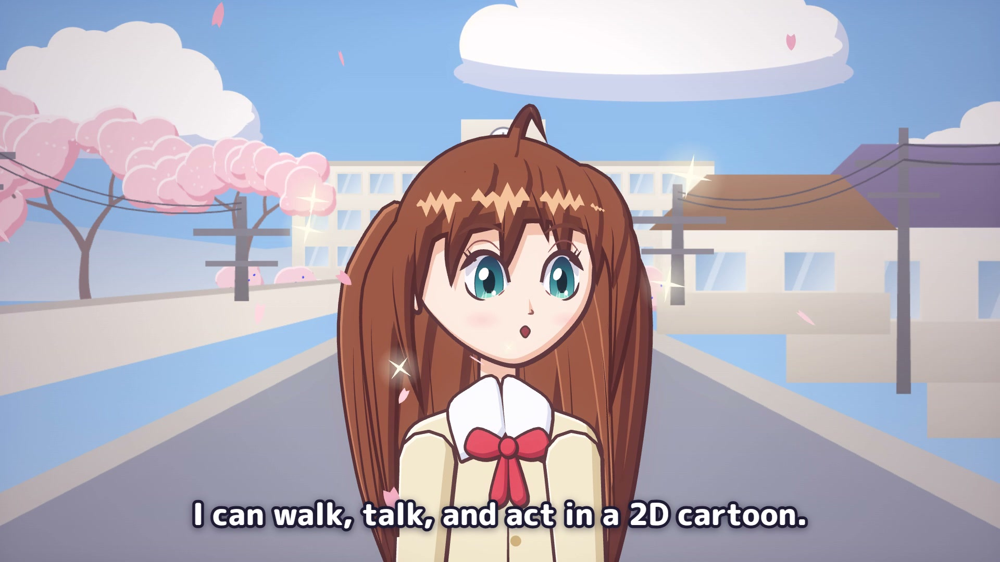
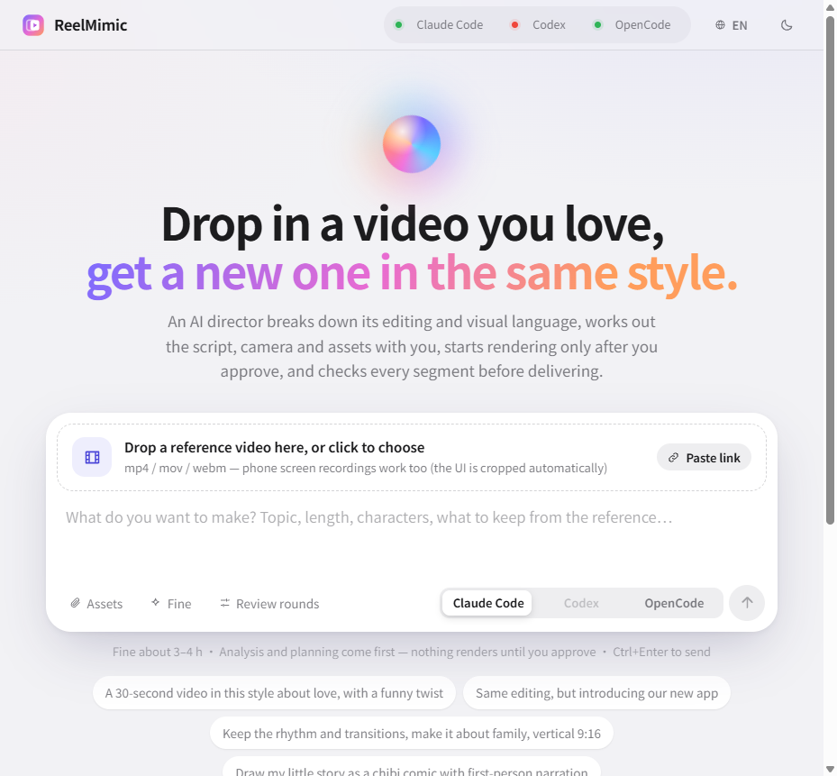

<p align="center"></p>

# Flick

**A working prototype of an AI 2D animation agent: script → voice → lip-sync → animated MP4.**

[](https://github.com/Lianhahaha/Flick/actions/workflows/ci.yml)
[](LICENSE)




This repo contains the voice, lip-sync, and anime-cel pieces we built while
evaluating an AI agent that can generate real 2D character animation — not just
motion graphics.

The demo output is a **9.3-second, 1920×1080 anime-cel clip**: Hina walks in
from the left, stops, and speaks. Her voice is generated locally with Piper TTS,
and her mouth is driven by Rhubarb Lip Sync cues rather than a random lip flap.

[Watch the demo](demo/hina-walking-talking.mp4) · [What happens in it](demo/README.md) · [How it works](docs/architecture.md)

---

**New here?** Read [QUICKSTART.md](QUICKSTART.md) for the five-minute version.

## Requirements

| Requirement | Notes |
|---|---|
| Windows 10/11 | The bootstrap downloads Windows binaries; the core code is cross-platform |
| Git | To clone this repo and the upstream projects |
| Node.js 22.18+ | ReelMimic's app and the renderer |
| Python 3.10+ | Analysis, voice, and mouth mapping |
| FFmpeg + ffprobe | Encoding and media inspection |
| Google Chrome | Headless frame rendering |
| Claude Code, Codex, or OpenCode | Only for the full ReelMimic app; the demo video needs none |

## What works today

| Piece | Status |
|---|---|
| Local text-to-speech (Piper, offline) | ✅ Works |
| Audio → 8 mouth shapes (Rhubarb) | ✅ Works |
| Rhubarb A–H → ReelMimic mouth names | ✅ Works |
| 2D anime character walking | ✅ Works |
| 2D anime character talking with voice | ✅ Works |
| 9.3 s rendered MP4 with audio | ✅ Works |
| OpenCode director (DeepSeek V4.1 Flash) | ✅ Works via local patch |
| Tagalog/Filipino support | ⚠️ Phonetic recognizer; needs a Filipino voice model |
| Multi-character dialogue scene | 🔜 Next |
| Full ReelMimic production integration | 🔜 Next |
| Web editor / SaaS product | 🔜 Next |

## OpenCode support



ReelMimic upstream only lists Claude Code and Codex. This repo adds an
**OpenCode** director, so the app can run on a local OpenCode model such as
DeepSeek V4.1 Flash. Apply it with `scripts/bootstrap.ps1 -WithOpenCode`; see
[docs/opencode-adapter.md](docs/opencode-adapter.md).

## Why this stack

- **ReelMimic** is the only open-source project we found that renders real 2D
  animation frames with rigged characters that can walk, run, gesture, and talk.
  It is MIT-licensed and already has a full agent pipeline (analysis → plan →
  production → review).
- **Piper** gives us a local, permissively licensed voice with no API key.
- **Rhubarb Lip Sync** turns the voice into concrete mouth shapes for 2D
  characters.
- **Toonflow** is included as a reference only: it is a strong script-to-AI-video
  platform, but its output is AI video/motion comic, not frame-by-frame 2D.

## Repository layout

```text
QUICKSTART.md                  the short version: run the demo in five minutes
demo/
  README.md                    what the demo shows
  hina-walking-talking.mp4     rendered 2D anime clip with voice
  hina-walking-talking.jpg     poster frame
voice/
  tts_lipsync.py               Piper + Rhubarb CLI
  assets/                      Hina voice WAV + Rhubarb JSON cues
  demo/                        standalone interactive voice + lip-sync demo
  anime-demo/                  runnable ReelMimic anime-cel project
docs/
  architecture.md              how the pipeline fits together
  setup.md                     install and run
  roadmap.md                   what to build next
  licensing.md                 rights, licenses, and client-work notes
  opencode-adapter.md          run ReelMimic with DeepSeek via OpenCode
  comparison.md                ReelMimic vs Toonflow vs HyperFrames/OpenMotion
  faq.md                       common questions
patches/
  reelmimic-opencode-agent.patch
scripts/
  bootstrap.ps1                clone upstreams + download voice tools/models
third_party/                   redistributable license texts
```

## Why the repo is small

The repo contains only our code, docs, and the rendered demo. The other ~1 GB
is third-party and machine-generated:

- upstream source clones (ReelMimic, Toonflow, Piper, Rhubarb)
- downloaded binaries and voice models
- `node_modules`
- rendered frames and caches

Committing those would make every clone slow, duplicate upstream licenses, and
put machine-specific binaries into Git. `scripts/bootstrap.ps1` fetches the
exact upstream versions, so a collaborator gets the same working setup with two
commands.

## Quick start

### 1. Bootstrap the upstream tools

```powershell
powershell -ExecutionPolicy Bypass -File scripts/bootstrap.ps1 -WithOpenCode
```

This clones ReelMimic and optionally Toonflow, applies the OpenCode director
patch, then downloads the Piper and Rhubarb Windows binaries and the English
voice model. It does not install
ReelMimic's Python/npm dependencies; do that with ReelMimic's `install.bat`.

### Collaborator setup (fresh clone)

```powershell
git clone https://github.com/Lianhahaha/Flick.git
cd Flick
powershell -ExecutionPolicy Bypass -File scripts/bootstrap.ps1 -WithOpenCode
cd reelmimic
install.bat
```

That gives the same setup as this machine: ReelMimic, the OpenCode director
patch, Piper, Rhubarb, and the voice model. The demo video is already in the
repo. See [`docs/opencode-adapter.md`](docs/opencode-adapter.md) for the
DeepSeek configuration.

### 2. Try the standalone voice demo

Open `voice/demo/index.html` and press **Play voice**. The audio is embedded, so
this works offline.

### 3. Render the anime-cel clip

```powershell
cd voice/anime-demo
npm install
node render.mjs --frames --workers=4
node render.mjs --encode --out=out/video.mp4 --audio=assets/voice.wav
```

### 4. Generate a new voice line

```powershell
cd voice
python tts_lipsync.py "This is a new line." --out demo/line1
```

For Tagalog/Filipino:

```powershell
python tts_lipsync.py "Kumusta! Ako si Hina." --out demo/line1 --phonetic
```

## Render specs

| Property | Value |
|---|---|
| Resolution | 1920×1080 |
| Frame rate | 24 fps (character animation on twos) |
| Duration | 9.3 s |
| Video | H.264 |
| Audio | AAC |
| Voice | Piper `en_US-lessac-medium` |
| Lip-sync | Rhubarb Lip Sync 1.14.0 |
| Engine | ReelMimic anime-cel |

## Upstream projects

- [edenfunf/reelmimic](https://github.com/edenfunf/reelmimic) — MIT
- [rhasspy/piper](https://github.com/rhasspy/piper) — MIT
- [DanielSWolf/rhubarb-lip-sync](https://github.com/DanielSWolf/rhubarb-lip-sync) — MIT
- [HBAI-Ltd/Toonflow-app](https://github.com/HBAI-Ltd/Toonflow-app) — MIT (reference only)

Upstream repos, binaries, and models are **not** committed here. `scripts/bootstrap.ps1`
fetches them. See [NOTICE.md](NOTICE.md) and [third_party/](third_party/).

## Status and limits

This is a prototype, not a finished animation studio. It proves the hard part:
a 2D character can walk, talk, and speak with synchronized mouth shapes. It does
not yet have a screenplay schema, multi-character dialogue, a timeline editor,
or ReelMimic's full production/review loop wired to the voice track.

See [docs/roadmap.md](docs/roadmap.md) for the next milestones.

## Documentation

- [Quickstart](QUICKSTART.md)
- [Architecture](docs/architecture.md)
- [Setup](docs/setup.md)
- [OpenCode adapter](docs/opencode-adapter.md)
- [Comparison](docs/comparison.md)
- [FAQ](docs/faq.md)
- [Roadmap](docs/roadmap.md)
- [Licensing](docs/licensing.md)
- [Changelog](CHANGELOG.md)

## Contributing

Small, tested changes are welcome. Read [CONTRIBUTING.md](CONTRIBUTING.md) and
run:

```powershell
powershell -ExecutionPolicy Bypass -File scripts/check.ps1
```

If you are changing the ReelMimic app, also run its checks:

```powershell
cd reelmimic/app
npm run check
```

## Security

Do not report vulnerabilities in a public issue. See [SECURITY.md](SECURITY.md).

## Citation

If you use Flick in a write-up, cite it via [CITATION.cff](CITATION.cff).

## License

MIT for Flick's own code. Third-party components keep their own licenses; see
[NOTICE.md](NOTICE.md) and [docs/licensing.md](docs/licensing.md).
