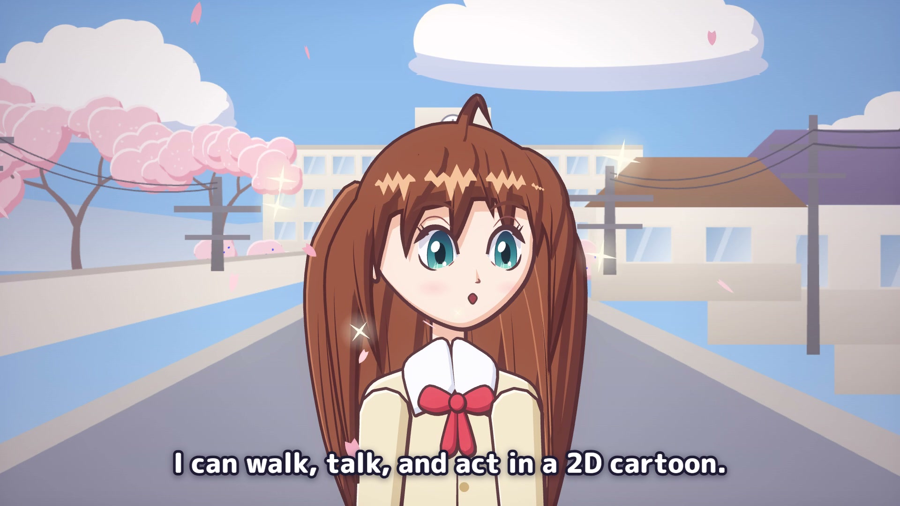

# Hina demo



A 10.1-second anime-cel clip rendered with ReelMimic's 2D engine.

## What happens

1. Hina walks in from the left on a sakura street.
2. She stops.
3. The shot cuts to a medium close-up.
4. She speaks with a Piper voice.
5. Her mouth follows the Rhubarb lip-sync track.

## Specs

| Property | Value |
|---|---|
| Resolution | 1920×1080 |
| Frame rate | 24 fps (character on twos) |
| Duration | 10.1 s |
| Video | H.264 |
| Audio | AAC |
| Voice | Piper `en_US-lessac-medium` |
| Lip-sync | Rhubarb Lip Sync 1.14.0 |
| Engine | ReelMimic anime-cel |

## Source

The runnable project is in [`../voice/anime-demo`](../voice/anime-demo).

```powershell
cd voice/anime-demo
npm install
npm run render
```

## Credits

- Anime-cel engine and characters: [ReelMimic](https://github.com/edenfunf/reelmimic) (MIT)
- `render.mjs` contract: ClaudeAnimationBase / painted-animation (MIT)
- Voice: [Piper](https://github.com/rhasspy/piper) (MIT)
- Lip-sync: [Rhubarb Lip Sync](https://github.com/DanielSWolf/rhubarb-lip-sync) (MIT)

See [`../NOTICE.md`](../NOTICE.md).
