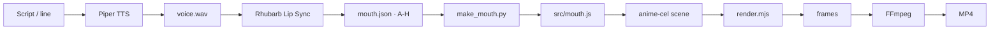

# Architecture

## The pipeline



```text
script / line
     │
     ▼
Piper TTS ──────────────► voice.wav
     │
     ▼
Rhubarb Lip Sync ───────► mouth.json  (A–H cues)
     │
     ▼
make_mouth.py ──────────► src/mouth.js (a / i / u / e / o / n)
     │
     ▼
anime-cel scene (voice.js) ──► render.mjs ──► frames ──► FFmpeg ──► MP4
                                     ▲
                                     └── ReelMimic anime-cel engine
```

The scene is still a normal ReelMimic anime-cel project. The only new part is
the mouth: instead of `talk(t)` choosing a random mouth shape, the scene calls
`window.mouthAt(t)` and gets the shape that matches the voice.

## Components

### 1. Piper TTS

- Local, offline neural TTS.
- Fast on CPU (the 9.3 s line rendered in about 0.6 s on this machine).
- Voice model is a separate `.onnx` + `.json` pair.
- `voice/tts_lipsync.py` wraps Piper and Rhubarb.

### 2. Rhubarb Lip Sync

- Analyzes the WAV and outputs mouth cues: `A B C D E F G H X`.
- `pocketSphinx` recognizer is best for English.
- `phonetic` recognizer is language-independent; use it for Tagalog/Filipino,
  at the cost of some precision.
- Output is a JSON list of `{ start, end, value }`.

### 3. Mouth mapping

`voice/anime-demo/make_mouth.py` maps Rhubarb's shapes to the anime-cel engine's
mouth names:

| Rhubarb | Anime-cel |
|---|---|
| X, A | `n` (closed) |
| B, D, H | `a` (open) |
| C | `e` |
| E | `o` |
| F | `u` |
| G | `i` (teeth) |

The generated `src/mouth.js` exposes:

```js
window.mouthAt(t) // 'a' | 'i' | 'u' | 'e' | 'o' | 'n'
```

### 4. ReelMimic anime-cel

The engine provides:

- Hina and Ren rigs, 19 expressions each
- walk/run cycles, gestures, props
- painted sets, camera moves, impact frames, subtitles
- a deterministic render contract (`renderAt(t)`), so frames can render in
  parallel and out of order

`src/scenes/voice.js` combines a wide walking shot with a medium close-up
talking shot. The close-up is important: the mouth needs to be large enough to
read.

## Why a cut to a close-up?

At a full-body wide shot, the mouth is only a few pixels. The demo walks in wide,
then cuts to a medium close-up for the dialogue. That is also how a real 2D
production would shoot it.

## Agent layer

The voice demo and the rendered clip do not need an agent. The full ReelMimic
app does: it sends a prompt to Claude Code, Codex, or OpenCode, and the agent
writes files following `CONTRACT.md`.

Upstream supports Claude Code and Codex. This repo adds OpenCode through a small
patch, so a local model such as DeepSeek V4.1 Flash can act as the director. The
voice pipeline itself is agent-agnostic.

## Integration points for the full agent

1. **Screenplay schema** — add scenes, beats, dialogue lines, character IDs,
   emotions, and voice IDs to the plan.
2. **Voice casting** — map each character to a TTS voice; generate one WAV per
   line; keep a manifest.
3. **Mouth tracks** — run Rhubarb per line, map to the engine, merge into one
   timeline.
4. **Shot assembly** — the existing ReelMimic production line builds shots; the
   voice track becomes another required input.
5. **Review** — add lip-sync and voice/character consistency checks to the
   reviewer checklist.

## Current limits

- One character, one line, one 9.3 s clip.
- No dialogue schema yet.
- No multi-character conversation.
- No timeline editor.
- The English Piper voice is serviceable but not ElevenLabs quality.
- Rhubarb's phonetic mode is approximate for non-English languages.
