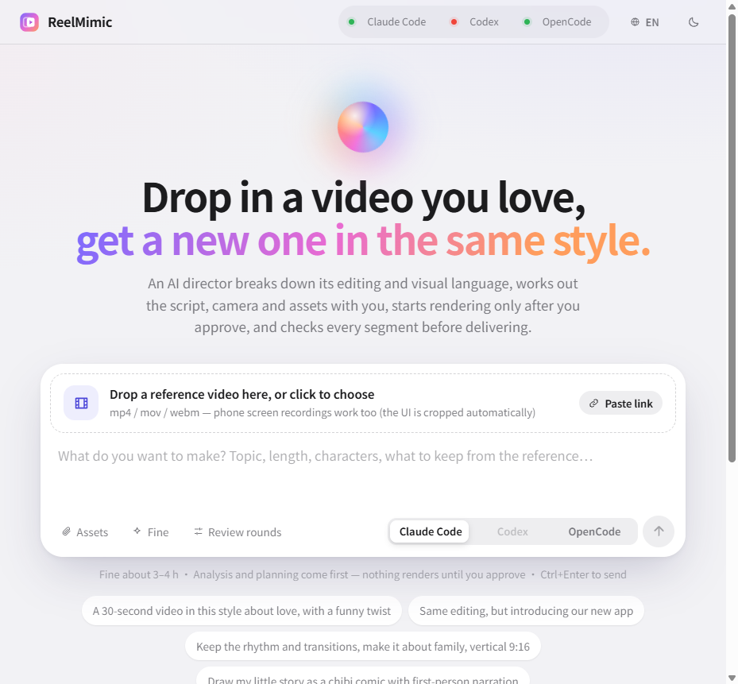
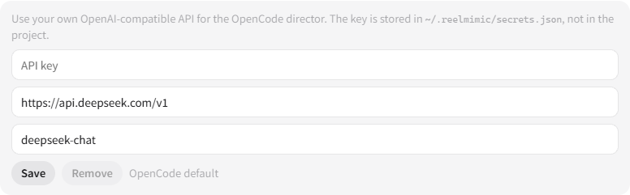

# OpenCode director adapter

ReelMimic upstream only spawns `claude` or `codex`. This patch adds **OpenCode**
as a third agent, so the app can use a local OpenCode model such as
**DeepSeek V4.1 Flash** or **DeepSeek V4 Pro**.

Patch: [`../patches/reelmimic-opencode-agent.patch`](../patches/reelmimic-opencode-agent.patch)



## What the patch changes

| File | Change |
|---|---|
| `app/shared/types.ts` | `AgentKind` includes `'opencode'` |
| `app/server/agents/index.ts` | Detects `opencode`, runs `opencode run`, parses its JSON stream, resumes sessions |
| `app/server/index.ts` | Accepts `opencode`, serves `/api/custom-api` |
| `app/server/custom-api.ts` | Stores the key, writes the OpenCode provider config |
| `app/web/src/App.tsx` | OpenCode picker, header status, API key panel |
| `app/web/src/Chat.tsx` | Shows the OpenCode label |
| `app/server/agents/index.test.ts` | Tests the OpenCode parser |
| `app/server/env.ts` | Documents the new environment variables |
| `.gitignore` | Ignores the generated `.opencode/` config |

The adapter runs:

```text
opencode run --format json --auto --model <model> --agent <agent> [--session <id>]
```

The prompt is sent through **stdin**, so long prompts never hit the Windows
command line.

## Apply it

### Option A: bootstrap with the patch

```powershell
powershell -ExecutionPolicy Bypass -File scripts/bootstrap.ps1 -WithOpenCode
```

### Option B: apply manually

```powershell
cd reelmimic
git apply ../patches/reelmimic-opencode-agent.patch
cd app
npm run build
```

Then restart the server.

## Configure

Code defaults (override them in `~/.reelmimic/secrets.json`):

| Variable | Default | Meaning |
|---|---|---|
| `OPENCODE_BIN` | `opencode` | Path to the OpenCode CLI |
| `OPENCODE_MODEL` | `opencode-go/deepseek-v4.1-flash` | Model in `provider/model` form |
| `OPENCODE_AGENT` | `build` | OpenCode agent profile |

Put overrides in `~/.reelmimic/secrets.json` or the environment:

```json
{
  "OPENCODE_MODEL": "opencode-go/deepseek-v4.1-flash",
  "OPENCODE_AGENT": "build"
}
```

### Add an API key in the app



1. Pick **OpenCode** in the composer.
2. Click **API key**.
3. Enter the key, an OpenAI-compatible base URL, and the model ID.
4. Click **Save**.

The adapter then uses the `reelmimic/custom` provider automatically. The key is
stored in `~/.reelmimic/secrets.json`; the non-secret provider settings are
written to `.opencode/opencode.json` (gitignored). No key is stored in the
project or returned by the API.

The endpoint must be OpenAI-compatible and the model must support tool calling.
Examples:

| Provider | Base URL | Model |
|---|---|---|
| DeepSeek | `https://api.deepseek.com/v1` | `deepseek-chat` |
| OpenAI | `https://api.openai.com/v1` | `gpt-4.1` |
| OpenRouter | `https://openrouter.ai/api/v1` | `openai/gpt-4.1` |
| vLLM / LM Studio | your local `/v1` URL | your served model |

Click **Remove** to go back to `OPENCODE_MODEL`.

ReelMimic's chat is headless: OpenCode's interactive slash **menu** (typing `/`)
is not available inside an `opencode run` turn. ReelMimic handles these commands
itself in the project chat:

| Command | Result |
|---|---|
| `/help` | List commands |
| `/status` | Current stage and agent |
| `/model` | Current custom/default model |
| `/key` | Where to set the API key |

Any other slash command is sent to the director as a normal prompt, so custom
OpenCode commands can still be used if configured.

### Use your own DeepSeek API key directly

`opencode-go/...` is OpenCode Go's hosted provider. To use your own DeepSeek
API key instead:

```powershell
opencode auth list
```

You should see `DeepSeek API key stored`. Then pick a model:

| Model | Best for | Notes |
|---|---|---|
| `deepseek/deepseek-flash` | Faster and cheaper | Good for iteration and long productions |
| `deepseek/deepseek-v4-pro` | Better code/planning quality | Higher cost per turn; can be slower |

Set it in `~/.reelmimic/secrets.json`:

```json
{
  "OPENCODE_MODEL": "deepseek/deepseek-v4-pro",
  "OPENCODE_AGENT": "build"
}
```

Then restart ReelMimic. The adapter passes `--model` to OpenCode, so the
provider and API key are resolved by OpenCode, not ReelMimic.

Test the exact model before a production:

```powershell
opencode run "Reply with exactly: ok" --format json --model deepseek/deepseek-v4-pro --auto --agent build
```

The OpenCode UI label `OpenCode Go · max` means **OpenCode Go provider, max
variant**. It is not a separate "DeepSeek Max" model. The adapter does not add a
`#max` variant; set one explicitly only if your provider supports it.

If the direct model fails with `provider.quota` / `Insufficient Balance`, the
DeepSeek API key is valid but the account has no credit. Top up at
<https://platform.deepseek.com> or switch back to
`opencode-go/deepseek-v4.1-flash` until the balance is available.

## Verify in ReelMimic

```powershell
Invoke-RestMethod http://localhost:4318/api/agents
```

You should see:

```json
{
  "claude": "2.1.287 (Claude Code)",
  "codex": null,
  "opencode": "opencode v2.2.6"
}
```

The header will show a green **OpenCode** pill, and the composer will offer
**OpenCode** as a director.

## Tested

- `npm run typecheck`
- `npm run lint`
- `npm test` — 107 passed, 1 skipped
- `npm run build`
- Direct adapter run + session resume with DeepSeek V4.1 Flash
- A real file-write tool call through `opencode run --auto`

## Caveats

- This is a local patch, not an upstream ReelMimic feature. The patch is against
  commit `0c3bfa1`; if upstream changes those files, re-apply with `git apply -3`
  or rebase.
- OpenCode's `--auto` auto-approves tool calls. ReelMimic's app-level gates
  (plan approval, review loops, round limits) still decide what is accepted.
- Claude Code's harness hooks (secret-file protection, `projects/` git guard)
  do **not** run under OpenCode. Do not run untrusted prompts with secrets in
  the workspace.
- OpenCode uses the local OpenCode server/session. If it is busy or not
  authenticated, the turn fails and ReelMimic shows the error.
